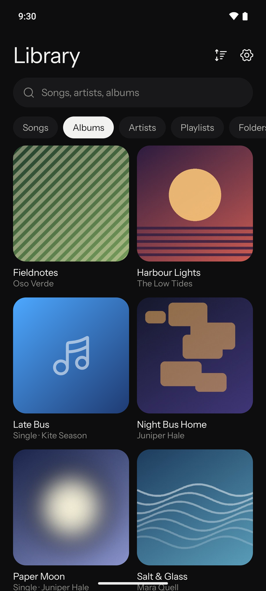
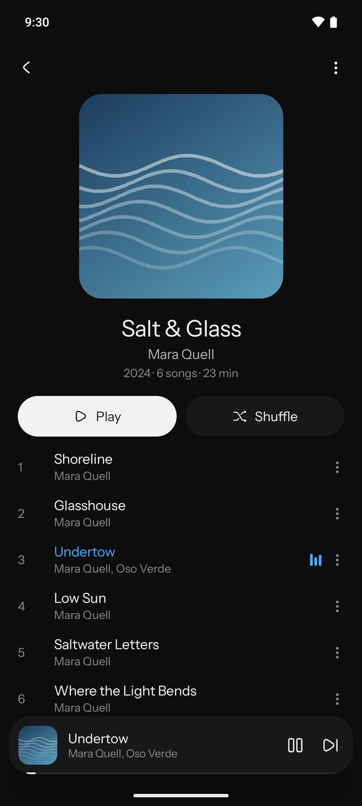
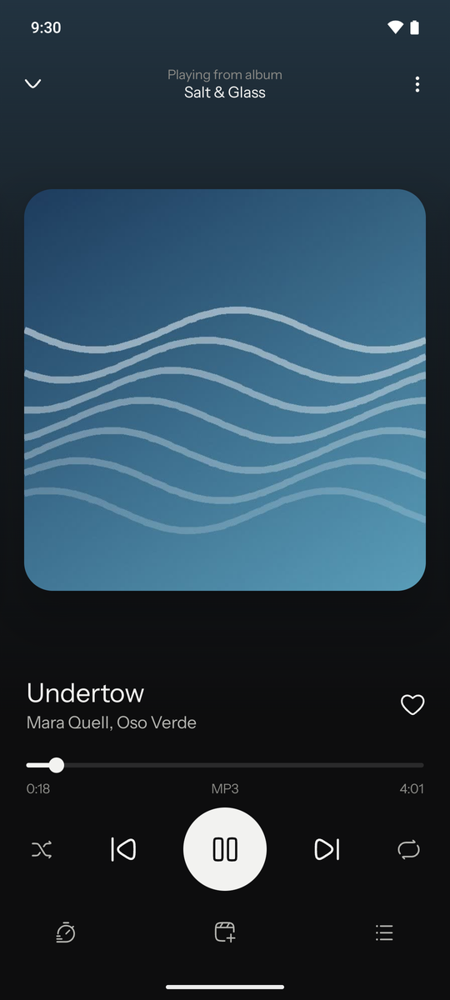
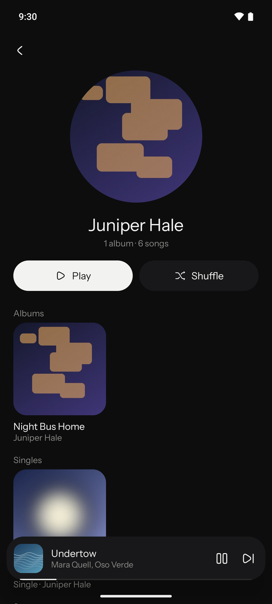

# Tide

A local music player for Android that gets your library right even when the tags are a mess.

Most stock players trust every tag exactly as written, so one stray space or a "feat." in a title splits an album in two. Tide works out what each file most likely is, the way Spotify would show it, and never needs you to rename files or fix tags first.

<p>
  
  
  
  
</p>

<sub>Screenshots use a made-up demo library.</sub>

## Features

- **Forgiving library.** Untagged files take their title and artist from the file name, "feat." moves from the title to the artists, one artist is spelt one way everywhere, and an album split by inconsistent tags is merged when its files share a folder. Fix anything by hand from a song's menu; the edit lives in Tide and the file isn't touched.
- **Playlists that don't break.** A playlist entry remembers the song (title, artist, length), not the file, so renaming, moving or re-tagging files doesn't drop it.
- **Import from Spotify.** Paste, or share to Tide from the Spotify app, a link to a song, album or playlist. Tide reads the track list from Spotify's public embed page (no account or API key), matches it against the music on your phone and saves a playlist. Songs you don't have stay in it and fill in when a matching file turns up. Tide only reads track lists; it doesn't download audio.
- **Several artists, one album.** "DJ Mykael V, 1995" is two people: the album shows on both artist pages, each name is tappable, and artist pages split into Albums, Singles and Appears on.
- **Playlists saved as albums.** A playlist that a download tool tagged as one album by Various Artists is spotted. Tide keeps it as a playlist and finds each song's real album, from the Spotify link many tools leave in the file or from Apple's public iTunes search. You see the results before anything is saved.
- **Tidy up** (Settings). Bins duplicate copies, moves every file into `Music/Artist/Album/NN Title.mp3` (or one folder) after saving playlist-like folders as playlists, and writes Tide's fixes into MP3 tags. Android asks before any file changes, and the audio itself is never rewritten. It does move and rename your files, so back up first if you care about the current layout.
- Gapless playback with Media3, lock-screen and notification controls, a reorderable queue, a sleep timer, Liked songs, hidden folders, and short clips (voice notes, ringtones) left out by default.
- Swipe the cover to peek at and skip to the next or previous song.

## Install

Android 10 (API 29) or later. There's no Play Store listing; build the APK yourself (below) and install it with `adb install` or by opening it on the phone.

Tide needs access to your audio files and, to show playback controls, notifications. Network access is used only for Spotify link imports and the iTunes album lookup.

## Build

Needs JDK 17+ and the Android SDK (set `sdk.dir` in `local.properties`, or `ANDROID_HOME`).

```
./gradlew :app:testDebugUnitTest   # tag logic, matching, Spotify parsing, ID3
./gradlew :app:assembleRelease     # app/build/outputs/apk/release/app-release.apk
```

Install the release build: Compose debug builds stutter when scrolling. It's signed with your local debug key unless you add a `keystore.properties` next to `settings.gradle.kts`:

```
storeFile=/path/to/release.jks
storePassword=...
keyAlias=...
keyPassword=...
```

## Code layout

All under `app/src/main/java/com/agmada/tide/`:

- `data/Tags.kt`, `data/Library.kt`: the forgiving tag logic and library builder (pure Kotlin, unit-tested)
- `data/Scanner.kt`: MediaStore scan; `data/Db.kt`, `data/TideRepo.kt`: playlists, edits and settings in Room
- `data/Organiser.kt` (planning, unit-tested) and `data/Tidy.kt` (doing): Tidy up; `data/Id3.kt`: ID3v2.3/2.4 reader and rewriter
- `importer/Spotify.kt`: Spotify link parsing and embed-page reader; `importer/AlbumFinder.kt`: a song's real album from Spotify or iTunes
- `playback/`: the Media3 session service, saved queue and sleep timer
- `ui/`: Jetpack Compose screens

## Limits

- Spotify's embed page lists at most 100 tracks of a playlist. It's an undocumented page, so imports can break if Spotify changes it.
- Tidy up writes tags to MP3 only. Other formats are still moved and de-duplicated.

## Contributing

Issues and pull requests are welcome. Run the unit tests before opening a PR, and add a test when you change tag handling or matching in `data/` or `importer/`. Contributions are accepted under the same GPL-3.0 licence.

## Licence

Copyright © 2026 Agmada Allen Asa. Tide is free software under the [GNU General Public License v3.0](LICENSE): you can use, change and share it, and anything you distribute that's built on it must be released under the same licence. It bundles the Instrument Sans font (SIL Open Font Licence 1.1) and icons from Hugeicons' free Stroke Rounded set (MIT); see [THIRD_PARTY_NOTICES.md](THIRD_PARTY_NOTICES.md).

Tide isn't affiliated with or endorsed by Spotify or Apple.
